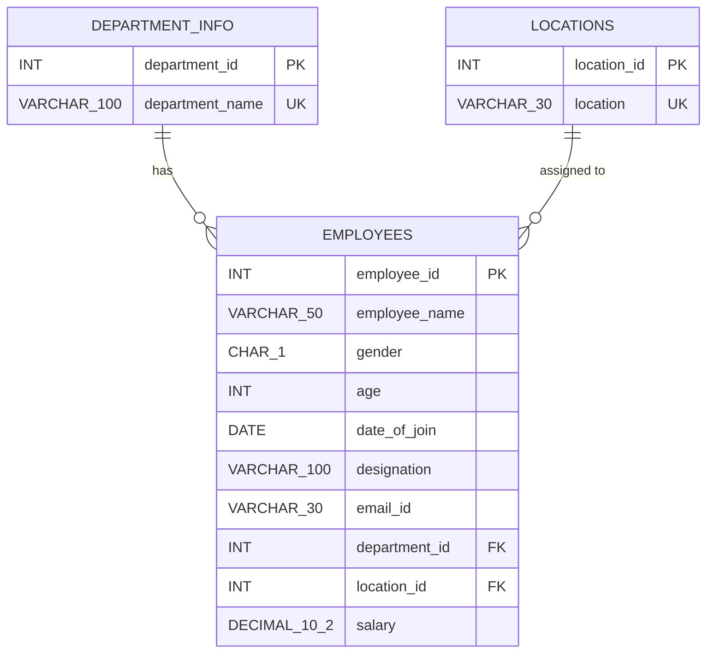
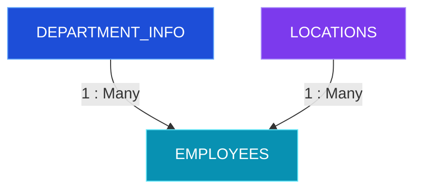
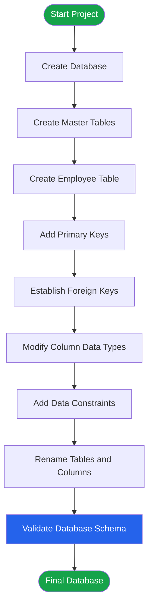

# 🏢 Employee Database Management System | MySQL

<!-- Animated Header -->
<div align="center">


<br/>


</div>

---

## 📌 01. Project Overview

The **Employee Database Management System** is a relational database project developed using MySQL.

The objective is to design a structured database to manage employee information, department details, and office locations while maintaining data accuracy, consistency, and referential integrity.

This project demonstrates practical SQL development and database engineering concepts, from initial table creation to final schema optimization.

<details>
<summary>🎯 <b>Project Highlights</b> — Click to expand</summary>

- Relational database architecture
- Three interconnected database tables
- Primary Key and Foreign Key relationships
- Data validation and integrity constraints
- Database normalization
- ALTER TABLE operations
- Column and table renaming
- Schema modification and optimization
- Entity Relationship Diagram (ERD)
- Consolidated production-oriented DDL

</details>

## 🛠️ 02. Technology Stack

<div align="center">

| Technology | Purpose |
|:---:|:---|
|  | MySQL Database |
|  | Version Control |
|  | Project Repository |
|  | SQL Script Editing |

</div>

## 🏗️ 03. Database Architecture

The database contains three relational tables.

<div align="center">

| Database Table | Responsibility | Table Type |
|:---|:---|:---:|
| `department_info` | Department master information | Dimension |
| `locations` | Office location master information | Dimension |
| `employees` | Employee information and references | Main Entity |

</div>

### 🔗 Database Relationship

- One department can have multiple employees.
- One location can have multiple employees.
- Each employee references one department and one location.

**Relationship:** One-to-Many (1:N)

## 📊 04. Entity Relationship Diagram (ERD)

The following diagram represents the final database schema, including primary keys, foreign keys, attributes, and relationships.



### Relationship Mapping

<div align="center">



</div>

## 🗂️ 05. Final Database Schema

### 🔵 Table 1: department_info

| Column | Data Type | Constraint |
|:---|:---|:---|
| department_id | INT | PK, AUTO_INCREMENT |
| department_name | VARCHAR(100) | NOT NULL, UNIQUE |

### 🟣 Table 2: locations

| Column | Data Type | Constraint |
|:---|:---|:---|
| location_id | INT | PK, AUTO_INCREMENT |
| location | VARCHAR(30) | NOT NULL, UNIQUE |

### 🟢 Table 3: employees

| Column | Data Type | Constraint |
|:---|:---|:---|
| employee_id | INT | PK, AUTO_INCREMENT |
| employee_name | VARCHAR(50) | NOT NULL |
| gender | CHAR(1) | CHECK (M/F) |
| age | INT | CHECK (age >= 18) |
| date_of_join | DATE | DEFAULT CURRENT_DATE |
| designation | VARCHAR(100) | NULL |
| email_id | VARCHAR(30) | NULL |
| department_id | INT | FK |
| location_id | INT | FK |
| salary | DECIMAL(10,2) | NULL |

## ⚙️ 06. SQL Development Workflow

The project follows a structured database development process.



### SQL Concepts Implemented

| SQL Operation | Implementation |
|:---|:---|
| CREATE DATABASE | Database creation |
| CREATE TABLE | Table creation |
| ALTER TABLE | Schema modification |
| ADD COLUMN | Adding email and age |
| MODIFY COLUMN | Changing data types |
| DROP COLUMN | Removing the original age column |
| RENAME COLUMN | Renaming hire_date |
| RENAME TABLE | Renaming master tables |
| PRIMARY KEY | Unique record identification |
| FOREIGN KEY | Referential integrity |
| UNIQUE | Duplicate value prevention |
| CHECK | Data validation |
| NOT NULL | Mandatory fields |

## 💻 07. Consolidated SQL DDL Script

The following script consolidates all the original SQL operations into the final database structure.

**MySQL Version:** 8.0.16 or later

```sql
-- =====================================================
-- PROJECT : EMPLOYEE DATABASE MANAGEMENT SYSTEM
-- DATABASE: employee
-- ENGINE  : InnoDB
-- =====================================================


-- 01. CREATE DATABASE

CREATE DATABASE IF NOT EXISTS employee
CHARACTER SET utf8mb4
COLLATE utf8mb4_unicode_ci;

USE employee;


-- 02. DEPARTMENT MASTER TABLE

CREATE TABLE IF NOT EXISTS department_info (

    department_id INT AUTO_INCREMENT,

    department_name VARCHAR(100) NOT NULL,

    CONSTRAINT pk_department_info
        PRIMARY KEY (department_id),

    CONSTRAINT uk_department_name
        UNIQUE (department_name)

) ENGINE = InnoDB;


-- 03. LOCATION MASTER TABLE

CREATE TABLE IF NOT EXISTS locations (

    location_id INT AUTO_INCREMENT,

    location VARCHAR(30) NOT NULL,

    CONSTRAINT pk_locations
        PRIMARY KEY (location_id),

    CONSTRAINT uk_location
        UNIQUE (location)

) ENGINE = InnoDB;


-- 04. EMPLOYEE TABLE

CREATE TABLE IF NOT EXISTS employees (

    employee_id INT AUTO_INCREMENT,

    employee_name VARCHAR(50) NOT NULL,

    gender CHAR(1),

    age INT,

    date_of_join DATE DEFAULT (CURRENT_DATE),

    designation VARCHAR(100),

    email_id VARCHAR(30),

    department_id INT,

    location_id INT,

    salary DECIMAL(10,2),

    CONSTRAINT pk_employees
        PRIMARY KEY (employee_id),

    CONSTRAINT chk_employee_gender
        CHECK (gender IN ('M', 'F')),

    CONSTRAINT chk_employee_age
        CHECK (age >= 18),

    CONSTRAINT fk_emp_dept
        FOREIGN KEY (department_id)
        REFERENCES department_info(department_id),

    CONSTRAINT fk_emp_loc
        FOREIGN KEY (location_id)
        REFERENCES locations(location_id)

) ENGINE = InnoDB;


-- 05. VERIFY DATABASE TABLES

SHOW TABLES;


-- 06. VERIFY TABLE STRUCTURES

DESCRIBE department_info;

DESCRIBE locations;

DESCRIBE employees;


-- 07. VERIFY FOREIGN KEY RELATIONSHIPS

SHOW CREATE TABLE employees;


-- =====================================================
-- DATABASE SCHEMA CREATED SUCCESSFULLY
-- =====================================================
```

### ⚠️ Engineering Notes

- The final schema is created directly instead of executing every historical ALTER statement.
- The original age column was dropped and subsequently added again; the final version retains it with a CHECK constraint.
- The original department and location table names are replaced with `department_info` and `locations`.
- The destructive `DROP DATABASE` operation is excluded.
- `IF NOT EXISTS` prevents duplicate creation errors but does not migrate or update an existing schema.
- Foreign key columns are nullable in this version, matching the original definitions.
- No cascade deletion is configured; MySQL's default restrictive foreign key behavior applies.
- CHECK constraints are enforced in MySQL 8.0.16+.

## 🧠 08. Database Engineering Concepts

### 1. Normalization

Department and location information are stored separately to reduce duplicate data and maintain consistency.

### 2. Referential Integrity

Foreign key constraints prevent employees from referencing department or location records that do not exist.

### 3. Data Governance

Data quality is maintained through:

- Mandatory employee names.
- Unique department names.
- Unique location names.
- Valid gender values.
- Minimum employee age validation.
- Controlled department and location references.

### 4. Constraint Strategy

| Constraint | Business Purpose |
|:---|:---|
| PRIMARY KEY | Unique record identification |
| FOREIGN KEY | Relationship management |
| NOT NULL | Mandatory data validation |
| UNIQUE | Duplicate prevention |
| CHECK | Business rule validation |
| DEFAULT | Automatic default values |
| AUTO_INCREMENT | Automatic ID generation |

## 🚀 09. Getting Started

### Prerequisites

- MySQL Server 8.0.16+
- MySQL Workbench
- Git
- GitHub Account

### Installation

**Step 1: Clone Repository**

```bash
git clone https://github.com/karthymani58/MYSQL
```

**Step 2: Navigate to Project**

```bash
cd employee-database-management
```

**Step 3: Open MySQL Workbench**

Connect to your MySQL Server.

**Step 4: Execute SQL Script**

Open `employee_database.sql` and execute the complete script.

**Step 5: Verify Database**

```sql
USE employee;

SHOW TABLES;

DESCRIBE employees;
```

**Step 6: Check Relationships**

```sql
SHOW CREATE TABLE employees;
```

## 📈 10. Future Improvements & Roadmap

| Improvement | Purpose | Priority |
|:---|:---|:---:|
| Index Optimization | Improve query performance | High |
| Audit Logging | Track employee modifications | High |
| Role-Based Access | Improve database security | High |
| Database Backup | Disaster recovery | High |
| Stored Procedures | Reusable SQL operations | Medium |
| Views | Simplify reporting queries | Medium |
| Triggers | Automated audit operations | Medium |
| Partitioning | Manage large historical tables | Low |

### Index Optimization Example

```sql
CREATE INDEX idx_employee_department
ON employees(department_id);

CREATE INDEX idx_employee_location
ON employees(location_id);

CREATE INDEX idx_employee_join_date
ON employees(date_of_join);
```

### Future Architecture Recommendations

- Implement audit logs with created_at and updated_at timestamps.
- Introduce database user roles and least-privilege access.
- Implement regular automated backups.
- Use version-controlled database migrations.
- Consider partitioning only for large historical datasets.
- Monitor query performance using EXPLAIN and EXPLAIN ANALYZE.

## 📁 11. Project Folder Structure

```text
Employee-Database-Management/
│
├── README.md
│
├── SQL/
│   └── employee_database.sql
│
└── Documentation/
    └── database_architecture.md
```

## 🎓 12. Skills Demonstrated

<div align="center">


</div>

- Relational Database Design
- MySQL Database Development
- Database Normalization
- Entity Relationship Modeling
- DDL Operations
- Data Integrity
- Primary and Foreign Keys
- SQL Constraints
- Database Architecture
- Schema Optimization

## 🏁 13. Conclusion

This project demonstrates the practical implementation of a relational database using MySQL.

From creating database tables to defining relationships, applying constraints, modifying schemas, and designing an optimized final structure, this project covers essential database engineering fundamentals.

**The goal is to develop a reliable, consistent, and maintainable database architecture using SQL.**

---

<div align="center">

### 👨‍💻 Developed By

# M. KARTHIK

**Data Analyst | SQL | Power BI | Excel | Python**


⭐ If you find this project useful, consider giving the repository a star!

**Thank You for Visiting!**

</div>
